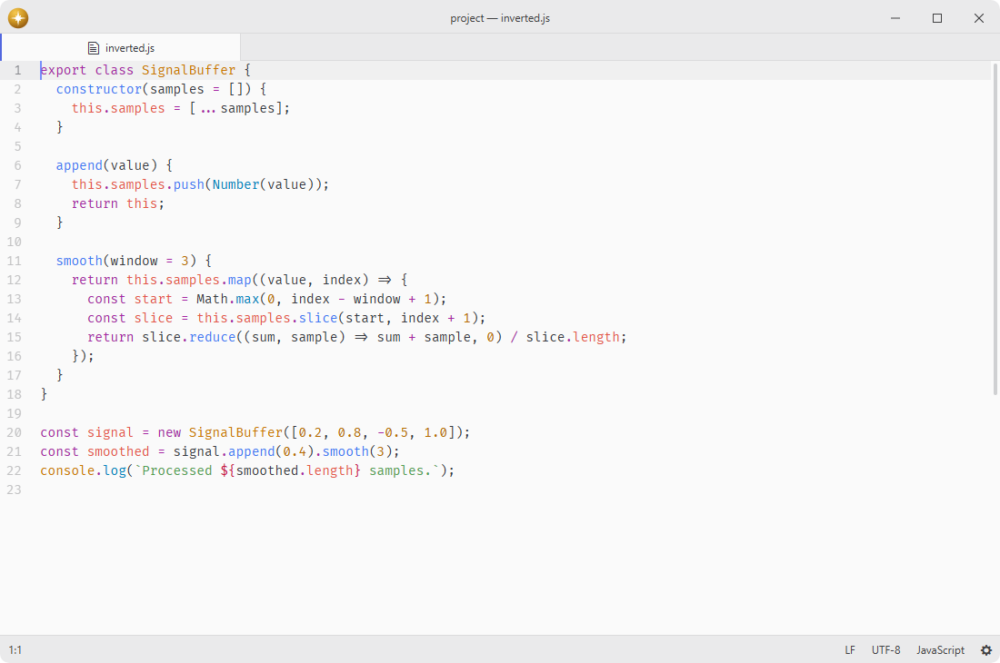
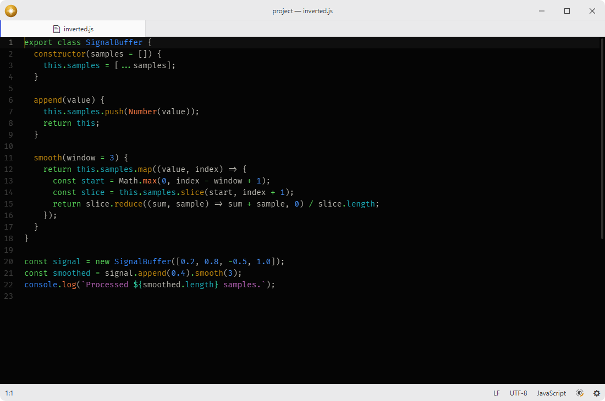

# invert-colors

Invert view colors for images, editors, and the PDF view.

Useful for dark themes or reducing eye strain.

## Features

- **Workspace inversion**: invert colors of the entire workspace.
- **Editor inversion**: invert colors of text editors only.
- **Image inversion**: invert colors of every ``, and of the canvases that draw a picture rather than a live view.
- **PDF support**: invert open and newly created PDF surfaces through their inversion providers.
- **Animated transitions**: smoothly transition into and out of inverted modes while respecting reduced-motion preferences.
- **Status bar indicator**: an optional contrast icon with four independently highlighted segments and a menu containing every inversion category.





## Installation

To install `invert-colors` search for it in the Install pane of the Lumine settings, or run the command `lumine --install lumine-code/invert-colors`.

## Commands

Commands available in `lumine-workspace`:

- `invert-colors:workspace`: toggle workspace inversion,
- `invert-colors:editor`: toggle editor inversion,
- `invert-colors:image`: toggle image inversion,
- `invert-colors:pdf-view`: toggle PDF view inversion,
- `invert-colors:disable-all`: disable every inversion category.

## Usage

Enable the status bar indicator with `invert-colors.statusIcon`; it is hidden by default. Its four segments show the active inversion categories, clockwise from the top right: workspace, text editors, images, and PDFs.

Left-click the indicator to disable all inversion. Right-click opens a menu with the four independent toggles and Disable All. Workspace inversion combines with the other categories, so enabling both workspace and editor inversion restores the text editors' original colors.

## Customization

Image inversion covers every ``, and only the canvases it knows to be pictures — a canvas is far more often a live renderer such as the minimap, the terminal or a 3D viewport, whose colors already come from the theme. To invert one it does not know about, name it in `styles.css`:

```css
body.invert-colors-image .my-package canvas {
  filter: invert(100%) !important;
}
```

## Services

- [invert-colors.provider](docs/invert-colors.provider.md): consumed to observe inversion targets and apply their category's color inversion state.
- `status-bar`: consumed to display the optional segmented contrast indicator in the status bar.

## Contributing

Got ideas to make this package better, found a bug, or want to help add new features? Just drop your thoughts on GitHub. Any feedback is welcome!
